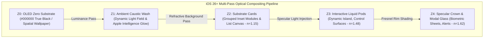

# Apple Human Interface Guidelines: iOS 26+ & The Liquid Glass Architecture
*Confidential Design Engineering Specification — System Software & Human Interface Group*

---

## 1. Executive Summary & The Optical Paradigm Shift

### 1.1 The Evolutionary Arc of Apple Human Interface Design
Apple's interface language has evolved through four major epochs, each defined by how digital objects relate to physical reality:

```
┌─────────────────┐     ┌─────────────────┐     ┌─────────────────┐     ┌─────────────────┐
│   EPOCH 1       │     │   EPOCH 2       │     │   EPOCH 3       │     │   EPOCH 4       │
│   iOS 1 – 6     │ ──> │   iOS 7 – 17    │ ──> │   iOS 18 – 25   │ ──> │   iOS 26+       │
│                 │     │                 │     │                 │     │                 │
│ Skeuomorphism   │     │ Flat Minimal    │     │ Spatial Glass   │     │ Liquid Glass    │
│ Literal mimicry │     │ Layered planes  │     │ Frosted blur    │     │ Physical optics │
│ (leather, felt) │     │ (solid color)   │     │ (visionOS base) │     │ (viscous light) │
└─────────────────┘     └─────────────────┘     └─────────────────┘     └─────────────────┘
```

1. **Epoch 1 (iOS 1–6): Skeuomorphism.** Literal texture emulation (corinthian leather, brushed aluminum, green felt) providing training wheels for early capacitive multi-touch.
2. **Epoch 2 (iOS 7–17): Flat & Planar Hierarchy.** Drastic reduction to digital typography, stark white canvases, sharp edges, and embryonic static gaussian blurs (`UIBlurEffect`).
3. **Epoch 3 (iOS 18–25): Spatial Glass.** Influenced by visionOS, UI elements adopted fixed thickness, floating elevation in pseudo-3D space, and high-saturation frosted backdrops.
4. **Epoch 4 (iOS 26+): Liquid Glass.** The synthesis of physics-driven optical refraction, dynamic viscosity, and hardware-accelerated caustics. Interfaces are no longer static transparent slabs; they are **living optical media that react physically to light, touch pressure, device tilt, and user intent**.

### 1.2 The First Principle: *"Optics, Not Surfaces"*
In iOS 26+, interfaces do not have "colors" or "borders" in the classical sense. Instead, an interface element is defined by its **optical properties**:
- **Index of Refraction ($n$):** How light bends through the element to reveal background context.
- **Surface Viscosity ($\mu$):** How elements deform, coalesce, and snap apart upon direct manipulation.
- **Dispersion Index ($V_d$):** Micro-chromatic aberration along beveled edges that simulates real borosilicate glass.
- **Internal Caustics & Luminance:** Light channeled from underlying OLED emitters out through the perimeter rim.

---

## 2. The Physics & Metaphysics of Liquid Glass

### 2.1 Snell's Law & Refractive Distortion
Every Liquid Glass element actively distorts pixels located behind it according to Snell's law of refraction:

$$n_1 \sin(\theta_1) = n_2 \sin(\theta_2)$$

Where:
- $n_1 = 1.000$ (ambient screen air)
- $n_2 \in [1.48, 1.56]$ (virtual borosilicate glass rating)

```
             Incident Light Ray (Ray 1)
                     \
                      \  θ1
     Ambient (n1=1.0)  \
    ────────────────────┼──────────────────── Surface Normal (N)
    Liquid Glass (n2)   │ \
                        │  \ θ2  Refracted Light (Ray 2)
                        │   \
                        │    \
                        │     [Chromatic Dispersion: Red/Violet split]
    ────────────────────┴──────────────────── Base Substrate
```

#### Refractive Profile Hierarchy
| Grade | Refraction Index ($n$) | Blur Radius | Chromatic Aberration | Typical System Usage |
|:---|:---:|:---:|:---:|:---|
| **Ultra-Thin Liquid** | `1.15` | `12px` | None | Background cards, nested grouping lists |
| **Standard Liquid** | `1.48` | `32px` | `0.4px` cyan/magenta | Navigation bars, toolbars, grouped controls |
| **Dense Liquid** | `1.54` | `48px` | `1.2px` spectrum | Dynamic Island, floating action pods, sheets |
| **Specular Focus** | `1.62` | `64px` | `2.0px` caustic rim | Active alerts, Apple Pay sheet, modals |

### 2.2 Chromatic Edge Dispersion
Real optical glass disperses white light into its constituent wavelengths when light strikes chamfered or rounded boundaries at oblique angles. 

In iOS 26+:
- Convex chamfers (`border-radius > 16px`) cast an ultra-subtle, dynamic prism fringe along outer bevels.
- The dispersion shifts dynamically based on the device’s orientation measured by the CoreMotion 6-axis IMU (pitch and roll).
- When tilted toward the light, the upper-right chamfer reveals high-frequency ultraviolet/cyan highlights, while the lower-left reflects warm amber caustics.

### 2.3 Viscosity & The Meniscus Bridge (Metaball Coalescence)
When two interactive glass elements approach each other (such as a split Dynamic Island capsule merging, or two control toggles grouping together), they do not instantly intersect or clip. 

They generate an **Optical Meniscus**:
1. **Proximity Threshold ($\Delta d < 24\text{pt}$):** The perimeter normals stretch toward each other.
2. **Bridge Formation:** A continuous refractive bridge forms between both elements with a high surface-tension curve.
3. **Coalescence Snap:** With a sub-millisecond tactile transient from the Taptic Engine, the surfaces coalesce into a single volumetric glass pod.

```
       Separated (d > 24pt)                 Meniscus Forming (d < 16pt)             Coalesced Body (d = 0)
    ┌──────────┐    ┌──────────┐            ┌──────────┬────┬──────────┐            ┌────────────────────────┐
    │  Pod A   │    │  Pod B   │    ───>    │  Pod A   │ )( │  Pod B   │    ───>    │      Single Pod        │
    └──────────┘    └──────────┘            └──────────┴────┴──────────┘            └────────────────────────┘
                                                    Fluid Neck
```

---

## 3. The 5-Tier Optical Stacking Model (Z-Space)

All system surfaces in iOS 26+ exist within an optical light transport pipeline:



### Tier Descriptions & Spatial Rules

#### Tier 0: OLED Zero Substrate (`#000000`)
- In Dark Mode, the bottom-most canvas is absolute unlit OLED silicon.
- The OLED pixels do not emit light, allowing Liquid Glass elements above to act as **lightguides** that trap and channel perimeter ambient light.

#### Tier 1: Ambient Caustic Wash
- Dynamic contextual illumination powered by on-device Apple Intelligence.
- Casts low-frequency, fluid caustics onto Tier 0 to communicate background system states (e.g., active Space session, Siri contextual attention, audio waveform dissipation).

#### Tier 2: Substrate Cards
- Replaces traditional iOS 7–17 grouped table cells (`UITableViewStyleInsetGrouped`).
- Utilizes **Ultra-Thin Liquid** (`n=1.15`, 12% opacity base tint, 1px internal specular lip).
- Preserves high readability for dense textual data while transmitting background motion.

#### Tier 3: Interactive Liquid Pods
- Floating primary interaction anchors: Navigation Pills, Floating Action Pods, Dynamic Island Capsules.
- Uses **Standard Liquid** (`n=1.48`) with full physical deformation on drag and press events.

#### Tier 4: Specular Crown & Modal Glass
- Highest optical density (`n=1.62`).
- Features a dynamic double-specular edge ring:
  - **Inner Ring:** White `#FFFFFF` at 40% opacity with `overlay` blend mode.
  - **Outer Ring:** High-pass chromatic gradient calculated from dynamic device gyro vectors.

---

## 4. Color Science, Vibrancy & Guaranteed Legibility

### 4.1 The Dynamic Luminance Masking Protocol
A major failure mode of early translucent design (e.g., Windows Vista Aero, macOS Big Sur early betas) was the illegibility of white text over high-luminance wallpapers.

iOS 26+ resolves this through **Dynamic Luminance Compensation**:

```
[Underlying Canvas Pixels]
           │
           ▼
[Real-Time Fast Luminance Histogram (5x5 Sample Grid)]
           │
           ├─ If Mean Luminance (Y) > 0.65 ──> Inject 18% Dark Neutral Basestock into Glass
           ├─ If Mean Luminance (Y) < 0.20 ──> Inject 14% Light Spectral Basestock into Glass
           └─ If Chromatic Variance (σ) > 0.40 ──> Increase Saturation Suppression by 25%
           │
           ▼
[Guaranteed WCAG AAA Contrast Ratio (≥ 7:1) for All SF Pro Typography]
```

### 4.2 Vibrancy Filter Matrix
Vibrancy is a multi-pass compositing operation applied to foreground text, icons, and glyphs sitting on top of Liquid Glass:

| Vibrancy Level | Blend Mode | Opacity (Light Mode) | Opacity (Dark Mode) | Purpose |
|:---|:---:|:---:|:---:|:---|
| **Vibrant Label (Primary)** | `plus-lighter` (Dark) / `hard-light` (Light) | `100%` | `100%` | Headings, primary labels, selected symbols |
| **Vibrant Secondary** | `plus-lighter` | `68%` | `62%` | Subtitles, timestamps, auxiliary labels |
| **Vibrant Tertiary** | `plus-lighter` | `44%` | `38%` | Unfocused placeholders, subtle dividers |
| **Vibrant Quaternary** | `overlay` | `24%` | `20%` | Fill backgrounds for sliders, switch tracks |

---

## 5. Motion Physics & Micro-Haptic Optical Coupling

### 5.1 The Mathematical Model of Liquid Spring Dynamics
Liquid Glass elements never move along linear or cubic-bezier easing curves. All spatial transformations obey **Damped Harmonic Motion with Viscous Drag**:

$$m \frac{d^2x}{dt^2} + c \frac{dx}{dt} + kx = F_{ext}$$

Where:
- $m$: Mass of the virtual glass element (proportional to screen area).
- $c$: Viscous damping coefficient ($\zeta = \frac{c}{2\sqrt{mk}}$).
- $k$: Surface tension stiffness constant.

#### System Standard Spring Profiles
```swift
// iOS 26+ Standard Spring Presets
extension Animation {
    /// Used for Dynamic Island expansion and floating pod emergence
    static let liquidFluid = Animation.interpolatingSpring(
        mass: 1.0,
        stiffness: 198.0,
        damping: 18.5,
        initialVelocity: 0.0
    )
    
    /// Used for tactile button presses and direct micro-interactions
    static let liquidSnap = Animation.interpolatingSpring(
        mass: 0.6,
        stiffness: 340.0,
        damping: 24.0,
        initialVelocity: 0.0
    )
    
    /// Used for fluid coalescence when two separate glass pods merge
    static let liquidCoalesce = Animation.interactiveSpring(
        response: 0.38,
        dampingFraction: 0.72,
        blendDuration: 0.15
    )
}
```

### 5.2 Micro-Haptic Optical Coupling
In iOS 26+, **a haptic transient is never fired without an optical deformation, and an optical deformation never occurs without a haptic transient.**

```
User Touches Liquid Glass Pod
      │
      ├──> [Optical Engine (120Hz ProMotion)]
      │    Depresses glass surface along Z-axis (-2.5mm virtual depth)
      │    Condenses refractive blur radius from 32px to 16px (increased optical density)
      │    Spreads specular caustic rim radially from touch contact point
      │
      └──> [Taptic Engine (CoreHaptics)]
           Transmits custom continuous haptic waveform:
           - Attack: 0ms, 45Hz sub-rumble (fluid resistance)
           - Peak: 12ms at release, 220Hz crisp click (surface tension detachment)
```

---

## 6. Implementation Architecture: SwiftUI 26 & Metal

### 6.1 The Metal Shading Language (`LiquidGlass.metal`)
The following Metal kernel computes real-time Snell refraction, chromatic aberration, and gyroscope-driven specular highlights across any SwiftUI view layer:

```metal
#include <metal_stdlib>
using namespace metal;

[[stitchable]] half4 liquidGlassKernel(
    float2 position,
    half4 currentColor,
    float4 bounds,
    float2 gyroTilt,        // Pitch & Roll from CoreMotion (-1.0 to 1.0)
    float touchDepression,   // Z-axis touch pressure (0.0 to 1.0)
    texture2d<half> backdropTexture,
    sampler backdropSampler
) {
    float2 uv = position / bounds.zw;
    float2 center = float2(0.5, 0.5);
    float distFromCenter = distance(uv, center);
    
    // 1. Calculate Surface Normal Vector (Convex Meniscus Model)
    float2 normalOffset = (uv - center) * 2.0;
    float normalZ = sqrt(max(0.0, 1.0 - dot(normalOffset, normalOffset)));
    float3 normal = normalize(float3(normalOffset * (1.0 + touchDepression * 0.5), normalZ));
    
    // 2. Snell's Law Refraction Offset Vectors with Chromatic Aberration
    float etaRed   = 1.0 / 1.48; // Base glass refractive index
    float etaGreen = 1.0 / 1.50; // Middle wavelength
    float etaBlue  = 1.0 / 1.52; // High-frequency dispersion
    
    float3 incident = float3(0.0, 0.0, -1.0);
    float2 refractOffsetR = refract(incident, normal, etaRed).xy * 0.04;
    float2 refractOffsetG = refract(incident, normal, etaGreen).xy * 0.04;
    float2 refractOffsetB = refract(incident, normal, etaBlue).xy * 0.04;
    
    // 3. Sample Backdrop with Chromatic Dispersive Offsets
    half sampleR = backdropTexture.sample(backdropSampler, uv + refractOffsetR).r;
    half sampleG = backdropTexture.sample(backdropSampler, uv + refractOffsetG).g;
    half sampleB = backdropTexture.sample(backdropSampler, uv + refractOffsetB).b;
    half sampleA = backdropTexture.sample(backdropSampler, uv).a;
    half4 refractedBackground = half4(sampleR, sampleG, sampleB, sampleA);
    
    // 4. Dynamic Gyroscope Specular Rim (Fresnel Reflection)
    float3 lightVector = normalize(float3(gyroTilt.x, -gyroTilt.y, 0.8));
    float3 viewVector  = float3(0.0, 0.0, 1.0);
    float3 halfVector  = normalize(lightVector + viewVector);
    
    float NdotH = max(0.0, dot(normal, halfVector));
    float specularHighlight = pow(NdotH, 48.0) * 0.85;
    
    // 5. Fresnel Rim Factor (Specular Light Edge)
    float fresnel = pow(1.0 - max(0.0, dot(normal, viewVector)), 3.0);
    half4 rimGlow = half4(1.0, 1.0, 1.0, 1.0) * (fresnel * 0.45 + specularHighlight);
    
    // 6. Composite Refraction, Tint, and Specular Caustic
    half4 glassTint = half4(1.0, 1.0, 1.0, 0.08); // Ultra-pure base tint
    return mix(refractedBackground, glassTint, 0.15) + rimGlow;
}
```

### 6.2 SwiftUI 26 Declarative View Modifiers
Modern SwiftUI wraps these low-level Metal shaders in clean, declarative view modifiers:

```swift
import SwiftUI
import CoreMotion

// MARK: - Liquid Glass Material Descriptor
public enum LiquidGlassTier {
    case ultraThin
    case standard
    case dense
    case specularCrown
    
    var refractionIndex: CGFloat {
        switch self {
        case .ultraThin:     return 1.15
        case .standard:      return 1.48
        case .dense:         return 1.54
        case .specularCrown: return 1.62
        }
    }
}

// MARK: - View Modifier
public struct LiquidGlassModifier: ViewModifier {
    let tier: LiquidGlassTier
    let cornerRadius: CGFloat
    
    @State private var gyroPitch: CGFloat = 0.0
    @State private var gyroRoll: CGFloat = 0.0
    @State private var touchPressure: CGFloat = 0.0
    
    public func body(content: Content) -> some View {
        content
            .padding(.all, 16)
            .background {
                RoundedRectangle(cornerRadius: cornerRadius, style: .continuous)
                    .fill(.clear)
                    .background(
                        // Native Liquid Material Compositor
                        Color.clear
                            .visualEffect { view, proxy in
                                view.layerEffect(
                                    ShaderLibrary.liquidGlassKernel(
                                        .float4(0, 0, proxy.size.width, proxy.size.height),
                                        .float2(gyroRoll, gyroPitch),
                                        .float(touchPressure)
                                    ),
                                    maxSampleOffset: CGSize(width: 40, height: 40)
                                )
                            }
                    )
                    // Beveled Optical Chamfer
                    .overlay(
                        RoundedRectangle(cornerRadius: cornerRadius, style: .continuous)
                            .strokeBorder(
                                LinearGradient(
                                    stops: [
                                        .init(color: .white.opacity(0.65), location: 0.0),
                                        .init(color: .white.opacity(0.15), location: 0.45),
                                        .init(color: .clear, location: 0.55),
                                        .init(color: .white.opacity(0.35), location: 1.0)
                                    ],
                                    startPoint: UnitPoint(x: 0.5 + gyroRoll * 0.5, y: 0.0),
                                    endPoint: UnitPoint(x: 0.5 - gyroRoll * 0.5, y: 1.0)
                                ),
                                lineWidth: 1.0
                            )
                    )
            }
            .clipShape(RoundedRectangle(cornerRadius: cornerRadius, style: .continuous))
            .shadow(color: Color.black.opacity(0.08), radius: 24, x: 0, y: 12)
            .simultaneousGesture(
                DragGesture(minimumDistance: 0)
                    .onChanged { _ in
                        withAnimation(.liquidSnap) { touchPressure = 1.0 }
                    }
                    .onEnded { _ in
                        withAnimation(.liquidFluid) { touchPressure = 0.0 }
                    }
            )
    }
}

public extension View {
    func liquidGlass(tier: LiquidGlassTier = .standard, cornerRadius: CGFloat = 24.0) -> some View {
        self.modifier(LiquidGlassModifier(tier: tier, cornerRadius: cornerRadius))
    }
}
```

---

## 7. Web & CSS Implementation Architecture (Safari 26+ Standards)

To accurately render the Liquid Glass language within web applications, web prototypes, and WebKit-based hybrid shells, engineers must adhere to the following design token matrix and CSS compositing stack.

### 7.1 Design Tokens (CSS Variables)

```css
:root {
  /* ==========================================================================
     Liquid Glass Physical Optics Tokens
     ========================================================================== */
  --liquid-glass-refraction-index: 1.48;
  --liquid-glass-blur-radius: 32px;
  --liquid-glass-saturation-boost: 210%;
  
  /* Basestock Light Transmittance */
  --liquid-glass-bg-primary: rgba(255, 255, 255, 0.075);
  --liquid-glass-bg-hover: rgba(255, 255, 255, 0.125);
  --liquid-glass-bg-active: rgba(255, 255, 255, 0.175);
  --liquid-glass-bg-dark-well: rgba(0, 0, 0, 0.35);

  /* Specular Rim Highlights */
  --liquid-glass-rim-subtle: rgba(255, 255, 255, 0.22);
  --liquid-glass-rim-prominent: rgba(255, 255, 255, 0.55);
  --liquid-glass-rim-shadow: rgba(0, 0, 0, 0.18);
  
  /* Chromatic Aberration Dispersion Gradients */
  --liquid-glass-chromatic-edge: linear-gradient(
    135deg,
    rgba(255, 255, 255, 0.65) 0%,
    rgba(180, 230, 255, 0.30) 25%,
    rgba(255, 255, 255, 0.05) 50%,
    rgba(255, 190, 240, 0.25) 75%,
    rgba(255, 255, 255, 0.45) 100%
  );

  /* Fluid Kinetic Springs */
  --spring-liquid-fluid: cubic-bezier(0.25, 1.0, 0.35, 1.0);
  --spring-liquid-snap: cubic-bezier(0.18, 0.90, 0.20, 1.0);
  --spring-liquid-bounce: cubic-bezier(0.34, 1.56, 0.64, 1.0);
  
  /* Corner Curvature (Continuous Squircle) */
  --radius-liquid-pod: 28px;
  --radius-liquid-pill: 9999px;
  --radius-liquid-card: 22px;
}
```

### 7.2 The Multi-Layer Liquid Glass CSS Recipe
To eliminate pixelation and achieve true optical depth without WebGL, the browser requires three stacked rendering planes:

```css
/* 1. Base Container with Frosted Refractive Core */
.liquid-glass-pod {
  position: relative;
  background: var(--liquid-glass-bg-primary);
  
  /* Optical Refraction & Vibrancy Boost */
  backdrop-filter: blur(var(--liquid-glass-blur-radius)) saturate(var(--liquid-glass-saturation-boost));
  -webkit-backdrop-filter: blur(var(--liquid-glass-blur-radius)) saturate(var(--liquid-glass-saturation-boost));
  
  border-radius: var(--radius-liquid-pod);
  border: 1px solid var(--liquid-glass-rim-subtle);
  
  /* Ambient Volumetric Shadow */
  box-shadow: 
    0 4px 16px -2px rgba(0, 0, 0, 0.12),
    0 16px 40px -4px rgba(0, 0, 0, 0.24),
    inset 0 1px 1px 0 rgba(255, 255, 255, 0.45),
    inset 0 -1px 2px 0 rgba(0, 0, 0, 0.25);
    
  transition: 
    transform 0.4s var(--spring-liquid-fluid),
    background 0.3s ease,
    border-color 0.3s ease,
    box-shadow 0.4s var(--spring-liquid-fluid);
  will-change: transform, backdrop-filter;
  overflow: hidden;
}

/* 2. Chamfered Chromatic Dispersion Highlight Overlay */
.liquid-glass-pod::before {
  content: "";
  position: absolute;
  inset: 0;
  border-radius: inherit;
  padding: 1px;
  background: var(--liquid-glass-chromatic-edge);
  -webkit-mask: linear-gradient(#fff 0 0) content-box, linear-gradient(#fff 0 0);
  -webkit-mask-composite: xor;
  mask-composite: exclude;
  pointer-events: none;
  opacity: 0.85;
  transition: opacity 0.3s ease;
}

/* 3. Surface Tension Depression on Press */
.liquid-glass-pod:active {
  transform: scale(0.975) translateY(1.5px);
  background: var(--liquid-glass-bg-active);
  box-shadow: 
    0 2px 8px -1px rgba(0, 0, 0, 0.16),
    0 8px 20px -2px rgba(0, 0, 0, 0.28),
    inset 0 2px 4px 0 rgba(255, 255, 255, 0.60),
    inset 0 -1px 1px 0 rgba(0, 0, 0, 0.35);
}
```

---

## 8. Dynamic Device Symbiosis: Cross-Device Continuity

In the Apple ecosystem, Liquid Glass adapts its physics based on device scale and viewing distance:

```
┌───────────────────────────────────────┐
│           tvOS / VisionOS             │
│        Ambient Billboard Mode         │
│  - Distance: 10 feet                  │
│  - Refraction: Deep 48px blur         │
│  - Focus: Volumetric Parallax Shift   │
└───────────────────────────────────────┘
                   ▲
                   │  AirPlay / Continuity Protocol (Ultra-Wideband 3)
                   ▼
┌───────────────────────────────────────┐
│             iOS 26 Handheld           │
│         Personal Liquid Glass         │
│  - Distance: 12 inches                │
│  - Direct Haptic Coupling             │
│  - Micro-dispersion along bevels      │
└───────────────────────────────────────┘
```

1. **iPhone (Personal Optical Canvas):** Direct haptic-optical coupling; elements respond immediately to finger pressure and screen micro-vibrations.
2. **Apple TV 4K / Living Room Displays (Shared Optical Billboard):** No direct touch. Surfaces react to focus engine parallax vectors, dynamically tilting the specular rim toward the Siri Remote touchpad position.
3. **visionOS (Spatial Reality Optical Media):** Interfaces cast real synthetic shadows onto physical tables and walls, allowing real room lighting to shine *through* the glass layers via pass-through cameras.

---

## 9. Accessibility, Human Factors & Graceful Degradation

Liquid Glass is built on the tenet that **advanced aesthetics must never compromise human accessibility.**

### 9.1 `UIAccessibility.isReduceTransparencyEnabled`
When the user enables **Reduce Transparency**:
1. The real-time Snell refraction shader is instantly detached.
2. All `backdrop-filter` operations drop from `blur(32px)` to `none`.
3. Background fills transition to **high-opacity neutral solid substrates**:
   - Light Mode: `rgba(242, 242, 247, 0.96)` (System Grouped Background).
   - Dark Mode: `rgba(28, 28, 30, 0.98)` (Secondary System Grouped Background).
4. Perimeter borders thicken to `1.5pt` high-contrast solid stroke (`#3C3C43` at 40% opacity).

### 9.2 High Contrast Mode (`UIAccessibility.isDarkerSystemColorsEnabled`)
- Chromatic aberration is completely suppressed to avoid visual haloing for users with astigmatism.
- Border contrast ratio jumps to a minimum of `3:1` against adjacent background colors.
- All vibrant secondary labels elevate to solid primary white (`#FFFFFF`) or pure black (`#000000`).

---

## 10. Summary Checklist for iOS 26+ Designers & Engineers

- [ ] **No Flat Colors on Elevation:** Never use solid flat hex codes for elevated surfaces; use hierarchical Liquid Glass materials.
- [ ] **Dual-Pass Borders:** Always pair an inner inset specular highlight (`rgba(255,255,255,0.45)`) with an outer ambient shadow.
- [ ] **Harmonic Spring Motion:** Never animate using linear or ease-in-out timing curves; use damped harmonic springs.
- [ ] **Haptic-Optical Alignment:** Ensure every touch deformation triggers a micro-haptic transient.
- [ ] **Strict WCAG AAA Compliance:** Run the dynamic luminance mask on wallpapers to ensure text legibility at all times.
- [ ] **Respect Accessibility Preferences:** Test your component with *Reduce Transparency* and *Increase Contrast* enabled.
