# Apple Spaces: Scope Refinement & Strategic Improvements

**Document Purpose:** Consolidates strategic scope pivots, feature additions, ecosystem alignment checks, and UX execution steps based on user research feedback and mentor guidance.

---

## 1. Executive Strategic Pivot: The "Hangout Space" Wedge

### The Problem with Initial Scope
The original scope spanned multiple distinct Space archetypes (*Study, Dorm, Party, Presentation, Workout*) across 6+ device categories. While conceptually versatile, it dilated team focus, blurred the product positioning, and created conflicting user metrics.

### The Refined Focus: Temporary Social Hangout
- **Selected Archetype:** **Temporary Hangout Space** (informal dorm, apartment, or living-room hangouts with friends).
- **Primary Hardware Anchor:** **iPhone + 1 Shared Anchor Device** ([HomePod](https://www.apple.com/homepod/) or [Apple TV](https://www.apple.com/apple-tv-4k/)).
- **Core Value Proposition:** Transitioning a hangout smoothly from **pre-hangout coordination** (RSVP, availability, pooled funds) into **during-hangout environmental orchestration** (music queue, ambient display, ephemeral location, zero-friction photo capture) with **automatic post-hangout teardown**.

---

## 2. Competitive Moat: "Isn't this just Apple Invites?"

A critical question from reviewers and stakeholders: *Apple already introduced event invites with RSVPs, shared albums, and collaborative playlists. Why does Spaces need to exist?*

| Dimension | Apple Invites / Event Links | Apple Spaces |
| :--- | :--- | :--- |
| **Nature** | **Static & Asynchronous:** A calendar card and a bundle of app URLs. | **Live & Environmental:** A real-time system state that reconfigures device behaviors in unison. |
| **System Surface** | Lives inside Apple Calendar or Messages as an invite message. | Lives in **Dynamic Island**, **Live Activities**, and **Control Center** as an active context. |
| **Device Interaction** | Each person interacts with their phone independently; manual AirPlay/Bluetooth pairing. | **Hardware Orchestration:** Devices respond collectively. HomePod enables zero-handoff shared queuing; Apple TV transforms into ambient event hub. |
| **Location & Arrival** | Manual Find My sharing or static address in Maps. | **Ephemeral Proximity State:** Activates arrival guidance on approach; auto-terminates location broadcast on arrival or session end. |
| **Lifecycle & Teardown** | Permanent unless manually deleted; links linger in messages. | **Time-Bounded & Ephemeral:** One-tap leave/end; permissions automatically revoke; prompts a clean "Keep or Discard" digest. |

> [!IMPORTANT]
> **Pitch Punchline:** *"Apple Invites tells your friends where to be. Apple Spaces changes how your space and devices behave once you get there."*

---

## 3. Resolving the Research Paradox: Pre-Hangout vs. During-Hangout

### The Tension in Our Data
- **What users said:** Their most acute, conscious pains are *before* the hangout: schedule availability, deciding what to do, and splitting expenses.
- **What Spaces solved:** Primarily *during* the hangout (music, Focus, photos, presence).

### Strategic Solution: The "Front-Door Bridge"
Instead of divorcing planning from the hangout, Spaces starts at the planning stage in Messages and naturally blooms into a live Space when the event begins.

```mermaid
flowchart LR
    A["Before Hangout (Planning)"] --> B["Arrival & Transition"] --> C["During Hangout (Live State)"] --> D["After Hangout (Teardown)"]
    
    subgraph A["Before: The Front Door"]
        A1["Smart Availability Matcher"]
        A2["Apple Cash Piggy Bank"]
        A3["One-Tap iMessage Invite"]
    end
    
    subgraph B["Transition: The Bridge"]
        B1["Dynamic Island Countdown"]
        B2["Live Arrival ETA / Find My"]
    end
    
    subgraph C["During: Multi-Device Magic"]
        C1["HomePod Collaborative Queue"]
        C2["Apple TV Ambient Visuals"]
        C3["Auto-Pooled Photostream"]
    end
    
    subgraph D["After: Zero Lingering Setup"]
        D1["One-Tap Expense Settlement"]
        D2["Shared Album Digest"]
        D3["All Permissions Revoked"]
    end
```

### New High-Impact Feature Enhancements

#### 1. Apple Cash "Piggy Bank" (Shared Event Kitty / Group Tab)
* **User Pain:** Splitting costs after hangouts is awkward, delayed, and involves third-party tools (Splitwise, Venmo).
* **Spaces Implementation:**
  * When creating a Hangout Space, the host can toggle a **"Group Piggy Bank"**.
  * Members can chip in an agreed amount (e.g., $10 for pizza/drinks) directly via **Apple Cash in iMessage**.
  * The pooled balance is visible in the Space overview. The host pays with Apple Pay from the Space balance, or remaining funds auto-refund equally when the Space closes.
  * Eliminates bill-chasing while reinforcing Apple Pay / Apple Cash utility.

#### 2. Calendar "Smart-Availability Matcher"
* **User Pain:** "When are you free?" text ping-pong across 5+ people in group chats.
* **Spaces Implementation:**
  * Host starts a Space draft in iMessage and selects "Find a Time".
  * iOS locally cross-references participants' free/busy blocks (using on-device intelligence without revealing calendar event titles to each other).
  * Suggests top 2–3 overlapping time slots directly in the chat bubble.

#### 3. Follow-up User Research Action Item
* Conduct **4–6 targeted follow-up user interviews** using *critical incident recall* around during-hangout moments:
  * *"Describe the last time you tried to play music at an apartment gathering—who connected, and how did people add songs?"*
  * *"How did you get photos from other people's phones the last time you hung out?"*
  * *"When someone couldn't find the apartment or buzzed the door, how did you coordinate?"*
* *Objective:* Uncover the implicit, tolerated friction that users don't think to complain about because "that's just how Bluetooth/AirDrop works."

---

## 4. Prompt Drift Check: Are We Drifting into Generic "Mobile Productivity"?

> [!WARNING]
> **Critical PM Assessment:** If Spaces only offers calendar polls, task lists, and expense splitting, it drifts into a third-party utility app (like Partiful + Splitwise). Apple does not build OS-level features to be a generic event planner. Apple builds them to **drive ecosystem lock-in, sell hardware, and showcase silicon/OS continuity.**

### Safeguarding the Multi-Device Identity
To stay true to the prompt (*facilitating multi-device group experiences within the Apple ecosystem*):

1. **Keep the "Before" features lightweight:** The Piggy Bank and Availability Matcher are strictly *entry funnels* inside iMessage, not a standalone productivity suite.
2. **Anchor on Hardware Interaction:** The core deliverable must highlight the **1+1 Device Model**:
   * **iPhone (Personal Agent):** Displays the Space in Dynamic Island, manages personal permissions, collects candid photos, and offers quick volume/track controls.
   * **HomePod or Apple TV (Shared Environmental Anchor):**
     * **HomePod Scenario:** Automatically unlocks guest music additions via proximity/SharePlay without anyone asking for Wi-Fi or Bluetooth pairing.
     * **Apple TV Scenario:** Serves as the "Party Billboard"—displays the current track, Live Photo photostream updates as guests take pictures, and group party games.
3. **OS-Level Exclusivity:** Third parties cannot silently bind Focus states, Dynamic Island, HomeKit accessories, and peer-to-peer UWB ranging. This proves why this must be an Apple feature, not an App Store app.

---

## 5. Non-Apple Friend Strategy (Cross-Platform Inclusivity)

### The Friction
In college social circles, having even 1 or 2 Android users can kill adoption of Apple-exclusive features if they are shut out.

### The Solution: Apple Spaces Web Experience (The "FaceTime Link" Model)
* Similar to how Apple allows Android and Windows users to join FaceTime calls via web browsers ([Apple Support: Join a FaceTime call from an Android or Windows device](https://support.apple.com/en-us/109364)):
  * The Space generates a secure, tokenized web link (`spaces.apple.com/join/...`).
  * **Android Guest Capabilities:**
    * RSVP and view hangout details (time, address, agenda).
    * Upvote or queue songs on the web-based music list.
    * Upload photos directly into the shared event pool.
    * Pay into the Apple Cash Piggy Bank via Apple Pay on the Web or standard debit/credit card.
  * **What remains exclusive to Apple hardware:** Dynamic Island state, hardware ambient automation (HomePod/Apple TV sync), system-level Focus mode synchronization, and background proximity haptics.
  * **Result:** No friend is excluded from the hangout, preserving social harmony while showcasing Apple ecosystem superiority.

---

## 6. Business Model & Strategic Revenue Framing

Instead of claiming Spaces will directly sell iPhones (an unrealistic claim for an OS feature), frame the business value across three strategic pillars:

1. **Accessory & Home Hardware Pull-Through:**
   * Demonstrates a direct, social reason for college students to purchase a **HomePod mini ($99)** or **Apple TV 4K ($129)** for their dorm/apartment common room.
2. **Services Engagement:**
   * Drives **Apple Music** subscriptions (required by host for collaborative SharePlay sessions).
   * Drives **iCloud+** storage tiers (as shared event photo dumps hit cloud quotas).
   * Expands **Apple Cash / Apple Pay** transaction volume via the Piggy Bank.
3. **Ecosystem Stickiness (Churn Reduction):**
   * Reinforces the social switching cost. Leaving iOS means losing seamless integration with group living and friend spaces.

---

## 7. Metrics & Measurement Framework

### North Star Metric (NSM)
* **30-Day Repeat Hangout Space Rate:** `% of users (hosts or guests) who create or participate in another Space within 30 days of their first session.`
  * *Why:* Validates organic utility, genuine habit formation, and social transmission without relying on vanity vanity signups.

### Secondary Supporting Metrics
* **Invite-to-Join Conversion Rate:** Measures friction of entering a Space from an iMessage card.
* **Anchor Device Coordination Rate:** `% of Spaces that connect at least one shared accessory (HomePod or Apple TV).`
* **Artifact Retention Rate:** `% of attendees who choose to keep the auto-compiled shared album or music playlist after teardown.`

### Guardrail Metrics (Tracking Privacy & Friction)
* **Early Abandonment Rate:** `% of Spaces terminated or exited less than 15 minutes after start.`
* **Location Sharing Opt-Out Rate:** `% of participants who toggle off location while keeping music/photo permissions active (must stay under 35%).`
* **Incremental Battery Impact:** Maximum allowable battery consumption < 2.5% per hour of background Space coordination.

---

## 8. UX, Wireframing & Prototyping Roadmap

### Phase 1: Storyboarding (Hangout Today vs. With Spaces)
* **Board A (Today's Friction):** 
  * "Where is everyone?" text flood.
  * Host passes phone around or disconnects Bluetooth for someone else to DJ.
  * Photos trapped on 4 different phones; never sent.
  * Awkward Venmo requests sent 3 days later.
* **Board B (With Spaces):**
  * One-tap invite in iMessage with pre-funded pizza fund.
  * Arrival triggers Dynamic Island notification; guest phone auto-connects to HomePod queue.
  * Photos snapped during the night land in the ephemeral pool.
  * Morning after: digest notification with photos and refund of leftover cash.

### Phase 2: User Flows & Edge Cases
Map low-fidelity logic for:
1. **Creation Flow:** Host sets name, duration, anchor device, and optional Piggy Bank.
2. **Join Flow:** Guest receives iMessage bubble $\rightarrow$ Preview permissions sheet $\rightarrow$ One-tap Join.
3. **Edge Case: Permission Granularity:** Guest denies location sharing $\rightarrow$ Space still grants music queue and photo access seamlessly.
4. **Edge Case: Android Guest:** Taps web link $\rightarrow$ Lightweight web viewer with photo upload & music queue.
5. **Teardown Flow:** Timer expires or Host ends Space $\rightarrow$ Immediate revocation of access $\rightarrow$ "Keep Photos?" summary sheet.

### Phase 3: System Surface Placement
* **Messages:** The *Creation & Invitation* surface.
* **Dynamic Island / Live Activity:** The *Active Glanceable Controller* (shows remaining time, current track, arrival status).
* **Control Center:** Quick toggle for personal privacy (e.g., mute presence, leave Space).

### Phase 4: Validation & High-Fidelity Deliverable
* Test paper/Figma wireframes with **5 Texas A&M students**.
* Build single, polished interactive demo flow in Figma using the official Apple iOS Design Kit.
